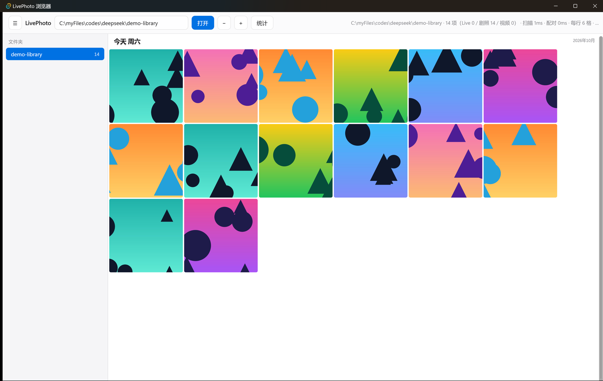
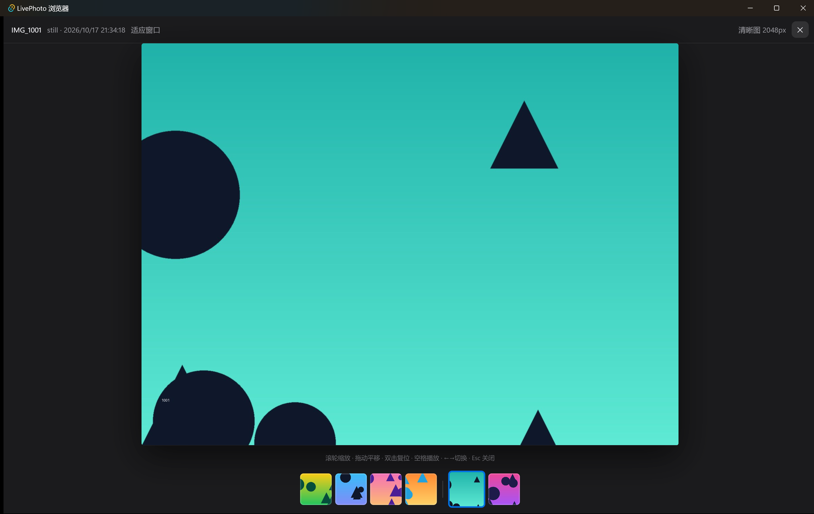

# LivePhoto 浏览器

### Windows 上最好用的 iPhone Live Photo 浏览器

双击打开一个照片文件夹，即可按 iOS 相册的方式浏览与播放。

Windows 自带的「照片」把 Live Photo 显示成一张静态 HEIC，资源管理器把 `IMG_1234.HEIC`
和 `IMG_1234.MOV` 当成两个互不关联的文件。这个工具把它们配回一张会动的照片。





> 截图为合成示例库（渐变色块生成的 14 张测试图），不含任何真实照片。

---

## 能做什么

- **Live Photo 原样播放**：直接播放系统 HEVC 扩展解码的原始 MOV，不转码、不生成预览缓存，保留原声
- **悬停即预览**：网格里鼠标停留 0.4 秒，该缩略图静音循环播放；移出即停
- **点按或空格播放**：全屏下以原声播放一次，切换到下一张自动播放
- **相册式浏览**：目录树、日期分组、月份时间轴、Ctrl+滚轮缩放缩略图、全屏放大至 8×
- **大视频直接播**：几个 GB 的片子点开即可播放，不复制、不转码
- **只读**：不导入、不复制、不改动任何照片；云端占位文件也不会被触发下载
- **单文件 4.6 MB**：免安装，无需 Node，不打包 Chromium

## 下载与运行

前往 [Releases](../../releases) 下载 `LivePhotoBrowser.exe`，双击运行并选择照片文件夹。

```powershell
# 也可以用环境变量直接指定目录
$env:LIVEPHOTO_OPEN="F:\DCIM"; .\LivePhotoBrowser.exe
```

**环境要求**：Windows 10 1809 及以上 / Windows 11；WebView2 运行时（Windows 11 已内置）；
HEIC / HEVC 解码使用微软「HEIF 图像扩展」与「HEVC 视频扩展」，多数品牌机已预装。

## 开发

```powershell
cd app; pnpm install; pnpm build                      # 前端 → app/dist
cd ..; cargo build --release -p app --features custom-protocol
```

> `--features custom-protocol` 为必需项：缺少它时 release 二进制会连接 `devUrl`，
> 窗口白屏且没有任何报错。

开发模式需要同时启动 Vite（`cd app; pnpm dev`），debug 版加载 `devUrl`。

构建产物体积、图标生成、性能实测数据等开发者向细节，见
[`docs/实施记录.md`](docs/实施记录.md) 与 [`docs/M0-实测发现.md`](docs/M0-实测发现.md)。

### 图标

`python tools/gen-icon.py --variant rf-halftone` 生成：奶油纸底、彩色像素点按拉丁方交错排列
（任意相邻点颜色都不同）、中心一圈同心环。一次输出 **9 个尺寸**（16–256）的 `icon.ico`
与各尺寸 png。

`tools/gen-icon.py` 里另有十余个备选变体（花瓣、胶片、CRT、包豪斯、网点、六角星、相机等），
`--sheet` 可以直接出对比图，改配色只需改调色板常量。
修改图标后需更新 `app/src-tauri/tauri.conf.json` 的时间戳再构建
（`tauri-build` 的 `rerun-if-changed` 不包含图标文件，否则 exe 会静默保留旧图标）。

## 已知限制

- 首次浏览大库时缩略图逐个生成：浏览不被阻塞，生成一次后永久命中缓存
- 全屏快速翻页时，超出解码速度的部分会在底部胶片条显示「正在准备」
- 日期取文件修改时间，尚未读取 EXIF 拍摄时间；滚轮由前端接管，没有原生惯性
- 只读浏览，v1 不含编辑与导出；目前提供绿色单文件，暂无安装包

## License

[MIT](LICENSE)

本仓库不包含任何编解码器；HEIC / HEVC 解码全部调用系统扩展。
